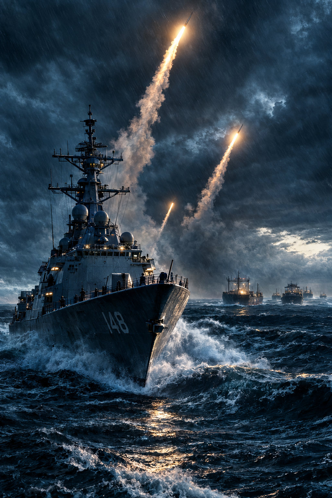
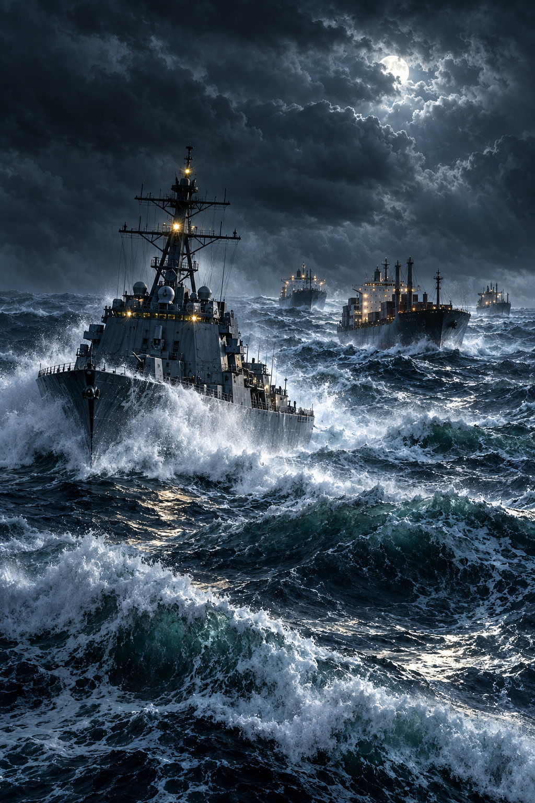
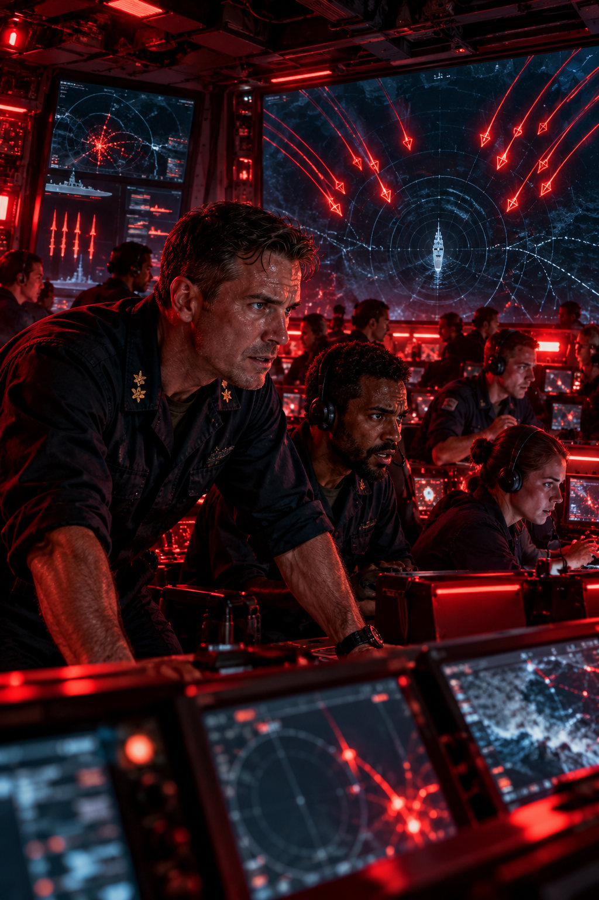
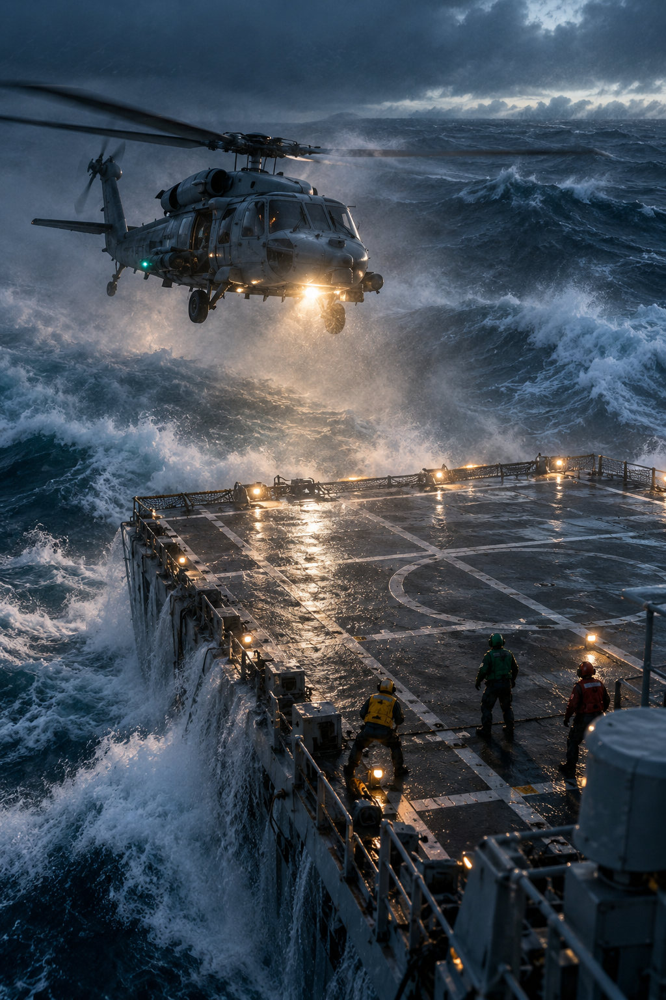
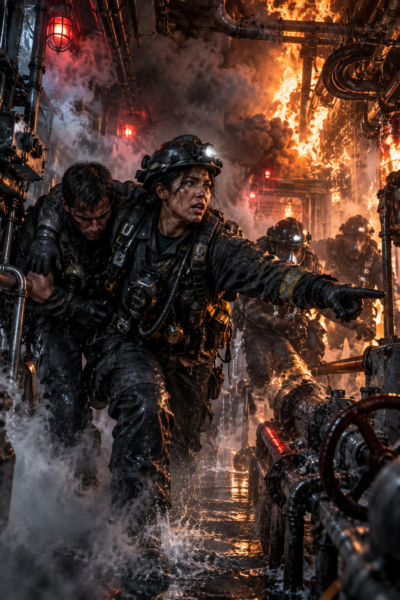
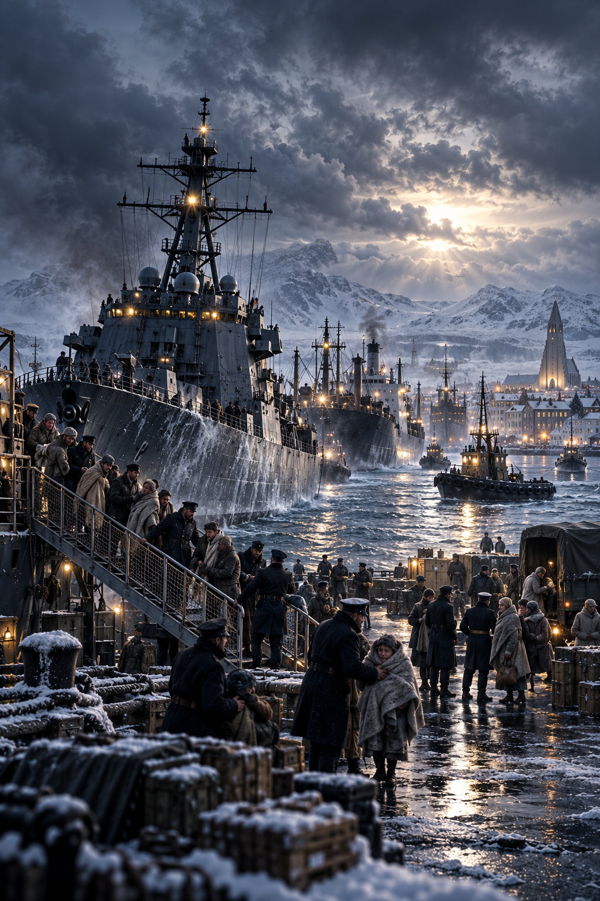

# THE LAST WATCH — CINEMATIC ART COLLECTION

**Writer:** Diesel • **Imprint:** DPN Novels • **Edition:** CINEMATIC-DIRECT-02

The repository now contains **eleven verified cinematic placements** — a cinematic image-based cover and **ten full-page scene illustrations**. They are embedded by the publisher into the actual PDF; this is no longer a pending manual ZIP upload.

## Preview gallery

| North Atlantic convoy | Combat information center |
|---|---|
|  |  |

| Raven One helicopter | Engineering fire |
|---|---|
|  |  |

| Reykjavík arrival | Liv's new home |
|---|---|
|  |  |

## Verified placements

| Illustration | Narrative scene |
|---|---|
| **USS Northstar DDG-148** | Full-color book cover |
| North Atlantic convoy | The First Crossing |
| Caledonia's survivors | The Distance Between Ships |
| Norwegian rescue crew | The Fisherman's Choice |
| Missile defenses | Before the Second Salvo |
| CIC missile engagement | The Twelve Tracks |
| Chief Ramirez's rescue | The Door With No Handle |
| Iceland harbor | The Pier at Reykjavík |
| Liv's new home | The Green Roof |
| Raven One helicopter | Raven One's Empty Seat |
| Caledonia in the storm | The Last Manifest |

## Reproducible publishing

- `committed_manifest.json` defines the images, exact manuscript anchors, titles and captions, relative source paths, and SHA-256 checksums.
- `scripts/cinematic_art.py` refuses missing files, altered checksums, unsafe paths, and ambiguous image placements.
- `scripts/build_book.py` includes the full-page artwork immediately before its corresponding scene and replaces the silhouette cover with the photographic DDG-148 cover.
- `.github/workflows/publish-book.yml` builds and validates the 6 × 9 inch PDF, tests the manuscript and illustration mapping, verifies image-bearing pages, and commits the new book to `books/The_Last_Watch_Extended_Edition.pdf`.
- Existing `manifest.json` describes the optional ZIP collection route for an alternative artwork release. **A ZIP upload is not required** for the checked-in edition.

## Quality and creative direction

The artwork is cinematic interpretation of a fictional naval conflict, **not historical photography**. Future plates should retain the correct Northstar designation **DDG-148**, visual consistency of the officers, North Atlantic weather and equipment, and a high-detail film-still finish rather than minimalist shapes. Print proofing and editorial review are still advisable before commercial distribution.

**[Download the cinematic PDF](../../books/The_Last_Watch_Extended_Edition.pdf)**.
