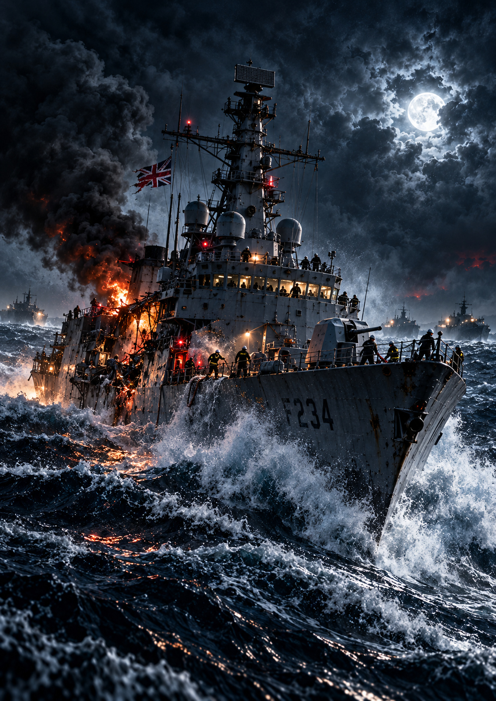
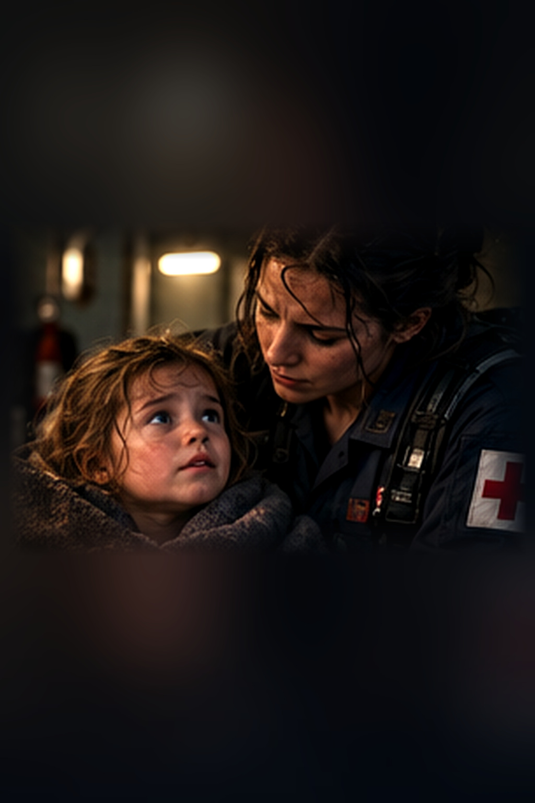
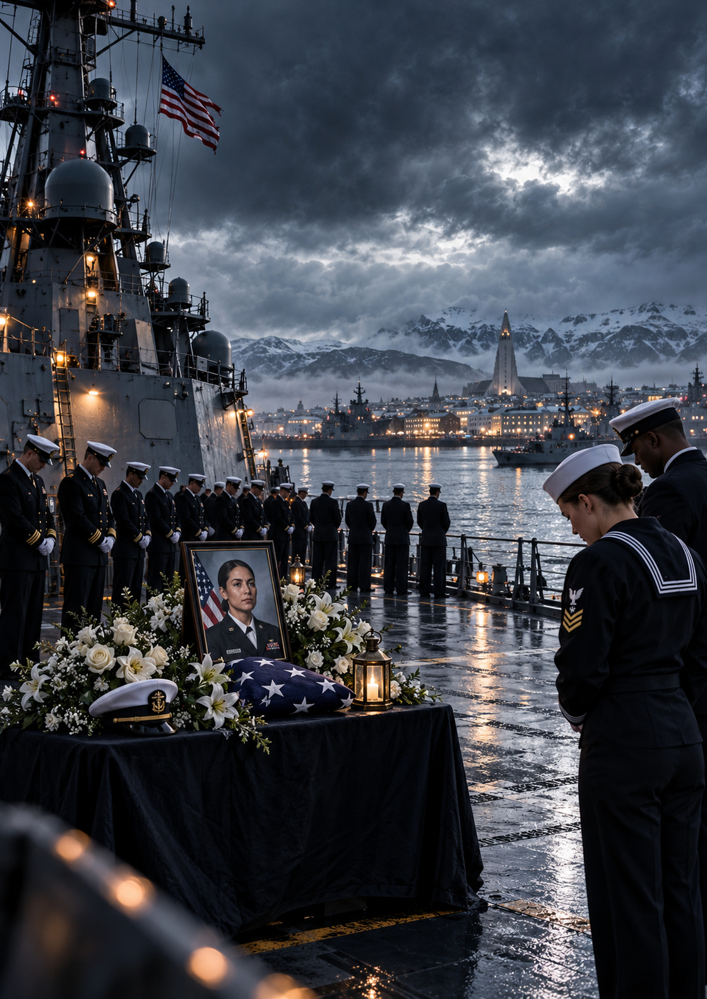
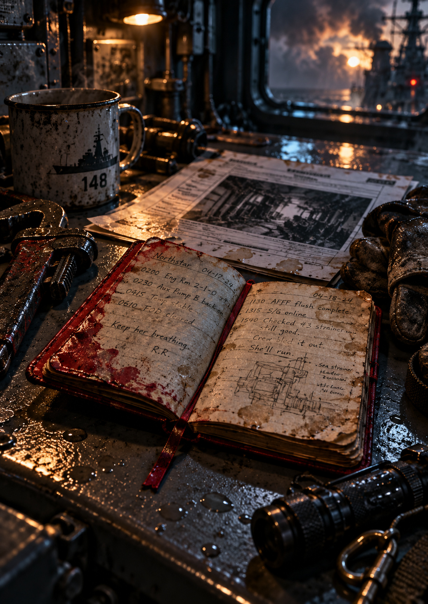
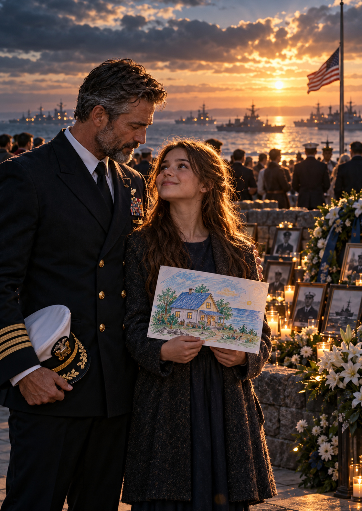

# THE LAST WATCH — CINEMATIC ART COLLECTION

**Written by Diesel • DPN Novels** · **CINEMATIC-DIRECT-04**

**Current verified edition:** 15 cinematic image placements — **one full-color cover and fourteen scene illustrations** — in the 481-page, 6 × 9-inch PDF. The narrative text remains at 76,146 words.

The illustrations are committed as real JPEG files and reproduced by GitHub Actions without downloading from an external image host. [Download the freshly rebuilt cinematic edition](../../books/The_Last_Watch_Cinematic_Illustrated_2026-10-24.pdf).

## Featured gallery

| HMS Cutlass: Still Fighting | The Children of Aurora |
|---|---|
|  |  |

| Remembrance | The Watchkeepers' Book |
|---|---|
|  |  |

| Raven One | Liv and Vale's homecoming |
|---|---|
|  |  |

## Exact manuscript placement

| Artwork | Book placement |
|---|---|
| **Northstar DDG-148** | Front cover |
| North Atlantic convoy | The First Crossing |
| Caledonia rescue | The Distance Between Ships |
| Fishermen aboard Sigrid | The Fisherman's Choice |
| Second salvo | Before the Second Salvo |
| Missile alert | The Twelve Tracks |
| Engineering fire | The Door With No Handle |
| Cutlass damaged bridge | **The Lieutenant's Bridge** |
| Child and caregiver | **Beneath Aurora** |
| Memorial watch | **Letters Never Sent** |
| Ramirez's watchkeeper notebook | **The Watchkeepers' Book** |
| Reykjavík harbor | The Pier at Reykjavík |
| Liv and Vale at remembrance | The Green Roof |
| Raven One's helicopter | Raven One's Empty Seat |
| Caledonia in the storm | The Last Manifest |

**All six newest illustrations are embedded and verified:** the new typeset-in-art front cover, HMS Cutlass, Aurora passengers, Ramirez's harbor memorial, the engineering watchbook, and Liv's reunion with Vale. The complete edition contains one cover and fourteen scene plates.

## Actual-PDF visual proofs

These previews are rendered from the **published PDF**, not independent source images:

- [View the new cinematic cover as printed on PDF page 1](../../books/proofs/New_Cinematic_Cover_Proof.jpg)
- [View the full 15-image PDF contact sheet](../../books/proofs/Cinematic_Art_Contact_Sheet.jpg)
- [Verify which PDF page contains each cinematic illustration](../../books/proofs/Cinematic_Pages.json)

The 481-page, checksum-verified PDF is also available at a **new filename** so readers do not unknowingly open an earlier cached version: [The Last Watch — Cinematic Illustrated, October 24, 2026](../../books/The_Last_Watch_Cinematic_Illustrated_2026-10-24.pdf).

## Publishing controls

- `committed_manifest.json` is the authoritative artwork manifest with manuscript anchors, filenames, captions and SHA-256 hashes.
- `scripts/cinematic_art.py` verifies each committed artwork file and rejects missing or modified images.
- `scripts/build_book.py` places a complete image page immediately before each matching scene and renders the photographic cover.
- `tests/test_cinematic_art.py` asserts all **15 placements**, image integrity, manuscript anchors, and 1024 × 1536 dimensions for the five new/updated assets.
- `.github/workflows/publish-book.yml` validates **at least 15 image-bearing PDF pages** and preserves searchable text, the author credit and the trim dimensions before publication.
- The older ZIP manifest remains an optional alternate publishing path; **no manual ZIP upload is needed**.

## Visual integrity notes

These are artistic renderings of a fictional naval conflict, not documentary photographs. The four newly added scene plates were adapted from cinematic storyboard illustrations. They are suitable for the digital reading edition; a high-resolution print proof is still necessary before professional color-print production. Character consistency, accurate Northstar DDG-148 markings, and safe illustration margins remain required quality checks.

[**Open the latest illustrated novel PDF**](../../books/The_Last_Watch_Extended_Edition.pdf)
